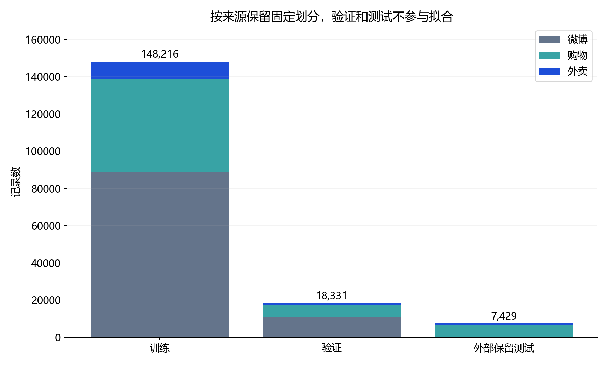
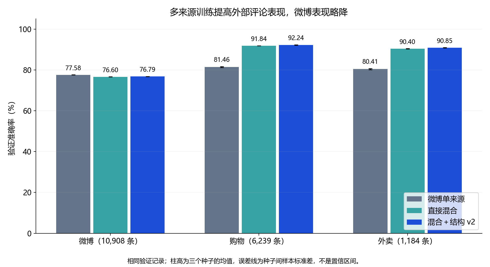
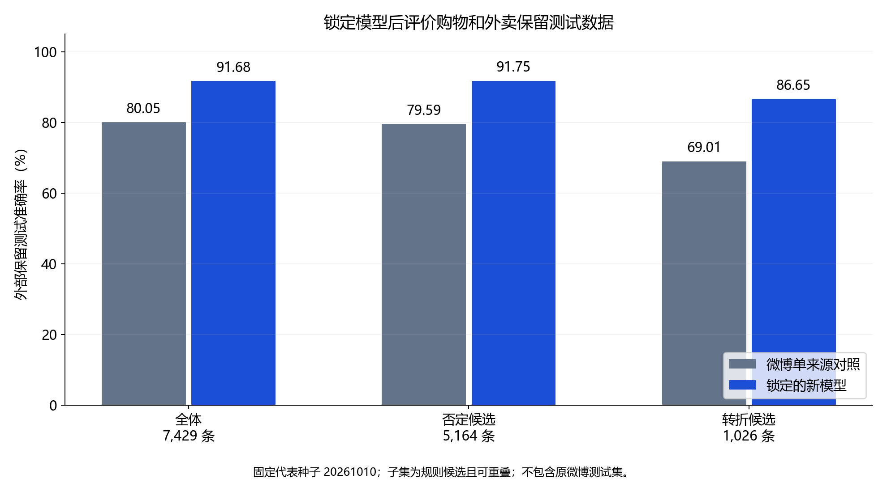

# 日常评论优化与多来源数据处理记录

日期：2026-10-11（Asia/Singapore）。运行编号：`20261011_133237`。

**本轮完成多来源清洗核验、固定划分、来源权重对照、否定/转折规则优化、15 次训练和锁定后的外部测试评价。** 人工情感标注继续暂缓，社群黑话不在本轮范围。

## 1. 数据从哪里来，如何处理

微博沿用已有 88,814 条训练、10,908 条验证数据。购物和外卖来自 SophonPlus/ChineseNlpCorpus 固定版本 `a0b781d72158bde242c0626c9e354d2b328865ff`。

两份外部原始数据共 74,761 条（购物 62,774、外卖 11,987）。校验原文件 SHA256 后，复用清洗脚本检查标签/空文本，统一空白，排除冲突、重复、过短指纹和与微博各划分重合的文本，得到 74,274 条；输出哈希与历史记录一致。各删减计数见 [原始清洗报告](external_data_audit.json)，不同层级的删减计数不可机械相加。

其中 20 条同时来自购物和外卖，单独隔离，避免给共有文本随意指定来源或双重计数。剩余 74,254 条按来源×标签分层，以固定种子和 ID 哈希排序，划为训练/验证/保留测试。

| 来源 | 训练 | 验证 | 新保留测试 |
| --- | ---: | ---: | ---: |
| 微博 | 88,814 | 10,908 | 原测试集未评价 |
| 购物 | 49,919 | 6,239 | 6,242 |
| 外卖 | 9,483 | 1,184 | 1,187 |
| 本轮合计 | **148,216** | **18,331** | **7,429** |

分组交集为 0；去重覆盖精确文本及既有正文指纹，仍无法排除全部语义近重复。新保留测试在选择记录锁定后才用于模型推理。来源标签保持 0=负向、1=正向，未人工逐条审定。



## 2. 从文本到特征

保留原文，生成去表情正文、否定候选位置和后续片段、同小句多次否定候选、最后一个转折词前/后的文本。`start` 是从 0 开始的 **clean_text 偏移量**，去表情可能使其不同于原文偏移量。所有处理轨迹保存在本地忽略目录，便于按 ID 回查。

v1 沿用前轮表面规则；v2 排除“特别、分别、别人、未来、无论、无数”等词内否定误命中和“但愿、不但、忙不过来”等转折误命中。排除候选不会改写正文或情感标签，局部片段最多 4 字，在标点/空白/有效转折处结束。

| 验证候选 | v1 | v2 |
| --- | ---: | ---: |
| 否定 | 10,280 | 10,113 |
| 转折 | 1,683 | 1,669 |
| 同小句多次否定 | 1,094 | 979 |

候选数减少只说明规则筛选发生变化，不能直接解释为识别准确率提高。所有模型采用同一份 v2 掩码评价子集，使比较分母一致。

## 3. 控制变量与训练

先固定字符 1—2 元 TF-IDF 和 SGD 逻辑回归，比较微博单来源、直接混合、来源×标签平衡。平衡组使用训练样本权重：每个来源/标签格子的总权重相同，整体平均权重约为 1；不复制训练记录，也不使用验证/测试分布计算权重。

阶段 A 选中直接混合，再比较基线、结构 v1、结构 v2。每组三个固定种子 20261010/11/12。词表、IDF、稀有否定特征筛选只拟合训练集。按三来源验证 Macro-F1 等权平均的三种子均值选方案，代表模型预先固定为 seed=20261010。

| 方案 | 三来源等权 Macro-F1 均值 ± 种子标准差 | 全体验证准确率均值 |
| --- | ---: | ---: |
| 微博单来源 | 0.794160 ± 0.000441 | 79.08% |
| 直接混合 | 0.858259 ± 0.000371 | 82.68% |
| 来源×标签平衡 | 0.857760 ± 0.000595 | 82.18% |
| 混合＋结构 v1 | 0.861512 ± 0.000467 | 82.93% |
| 混合＋结构 v2 | 0.861781 ± 0.000784 | 82.95% |

最终按预定指标选中 **直接混合＋结构 v2**。三个种子共用同一份数据，标准差只反映本轮优化随机性的变化；v2 相对 v1 的差距很小，不能据此宣称稳定领先。



微博验证准确率均值从同轮单来源的 77.58% 降到新模型的 76.79%；购物和外卖提升更明显。选择新模型是面向三来源日常评论的目标，并不表示它在所有来源都更好。

| 同一验证子集 | 微博单来源 | 混合字符基线 | 混合＋结构 v2 |
| --- | ---: | ---: | ---: |
| 否定候选 | 78.69% | 83.35% | 83.68% |
| 转折候选 | 72.12% | 80.37% | 81.51% |

最大的收益来自训练数据组成变化；额外结构特征的增益较小。混合方案同时增加了训练条数和来源，不能把优势全部归因于多样性。

## 4. 锁定方案后的保留测试结果

模型选择记录于 `daily_review_runs/20261011_133237/selection_lock.json`，事件日志证明锁定先于保留测试推理。仅评价选定模型和同轮、同代表种子的微博单来源对照，测试后未再调参。

| 外部保留测试 | 条数 | 微博单来源对照 | 新模型 |
| --- | ---: | ---: | ---: |
| 全体 | 7,429 | 80.05% | 91.68% |
| 购物 | 6,242 | 80.52% | 92.29% |
| 外卖 | 1,187 | 77.59% | 88.46% |
| 否定候选 | 5,164 | 79.59% | 91.75% |
| 转折候选 | 1,026 | 69.01% | 86.65% |

相对单来源对照，新模型改对 986 条、改错 122 条、两者仍错 496 条，净增 864 条正确。全体 Macro-F1 为 0.9165。



这里的 91.68% 仅对应这份购物/外卖保留测试，不能与历史微博测试准确率直接比较或宣称在线整体达到同样水平。子集是规则候选且可重叠，原标签未人工核验；外卖转折子集仅 96 条，波动与场景局限更大。

## 5. 已知用例和仍存在的问题

新模型把“今天不开心”“我一点也不喜欢原神”判为负向。仍把“这次服务没有让我满意”“虽然包装很漂亮，但东西实在太难用了”判为正向；这些开发用例说明否定范围、转折和多个评价对象尚未可靠处理。

诊断用例没有加入训练或用于选模型，也不计作独立准确率。具体分数是未经概率校准的决策值。本轮训练没有覆盖初版 `models/baseline.joblib`；网页当前启用的固定演示版本见 README，命令行与网页共用演示模型入口。

## 6. 成本、环境与过程记录

本轮完整执行约 94.9 秒，包括规则轨迹、五组×三种子训练、模型保存/重载和锁定测试评价。单机 Windows 11、Python 3.12.14、16 个逻辑处理器；本轮未进行 Spark/GPU 训练。模型核心包版本与前轮相同，详见结果 JSON。

| 方案 | 特征维度 | 向量化秒数 | 三次分类器拟合秒数 |
| --- | ---: | ---: | --- |
| 微博单来源 | 120,000 | 5.957 | 0.407, 0.377, 0.375 |
| 直接混合 | 120,000 | 8.423 | 0.566, 0.609, 0.611 |
| 来源×标签平衡 | 120,000 | 8.147 | 0.561, 0.554, 0.613 |
| 混合＋结构 v1 | 214,938 | 11.620 | 0.748, 0.769, 0.707 |
| 混合＋结构 v2 | 214,082 | 11.683 | 0.799, 0.763, 0.707 |

向量化时间包含训练拟合与验证转换，规则提取另计；模型序列化也有开销。所有计时为本机运行值，不作集群加速或不同工具速度优劣结论。

## 7. 文件和使用方法

- [训练前固定方案](daily_review_protocol.md)与[划分清单](daily_review_split_report.json)。
- [本次完整结果](daily_review_runs/20261011_133237/results.json)与[事件日志](daily_review_runs/20261011_133237/events.jsonl)。
- [本地逐条处理和预测目录](../data/processed/daily_review_runs/20261011_133237)：原文保存在 Git 忽略目录。
- [训练脚本](../scripts/train_daily_reviews.py)、[规则与权重](../daily_review_features.py)。
- [独立新模型测试入口](../scripts/predict_daily_reviews.py)。

```powershell
.\.venv\Scripts\python.exe scripts\predict_daily_reviews.py "今天不开心。" "我一点也不喜欢原神"
```

复现训练会创建新的时间戳目录，并再次评价该已使用的外部测试；后续重跑不能再称为首次独立测试。

```powershell
.\.venv\Scripts\python.exe -m unittest discover -s tests -v
.\.venv\Scripts\python.exe scripts\train_daily_reviews.py --prepare-only
.\.venv\Scripts\python.exe scripts\train_daily_reviews.py
```

生成报告图表需要安装 `requirements-report.txt`，运行 `python scripts/report_daily_reviews.py`。训练和推理仍使用 `requirements-demo.txt` 的核心依赖。

以上工作可用于课程的多来源管理、去重与划分、文本特征处理、效果评价和问题挑战部分。下一轮如继续优化，应采用新的评价设计；本次保留测试已完成使用。
